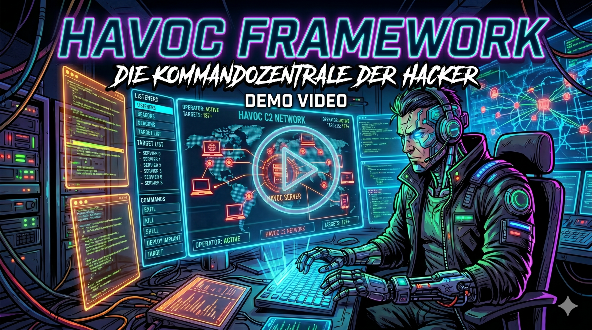
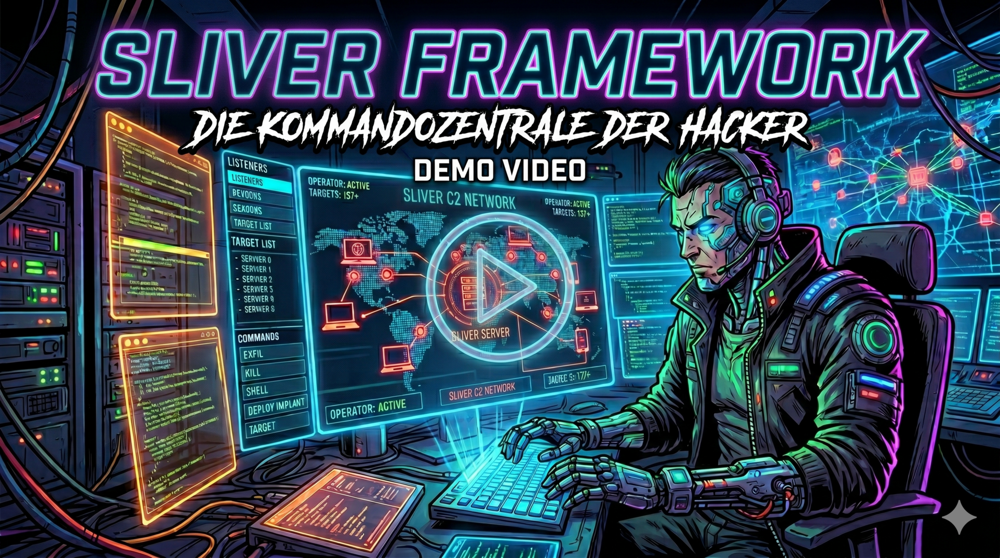
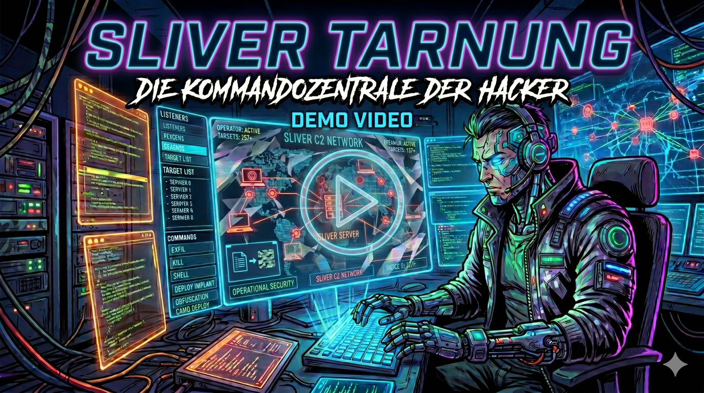


Disclaimer upfront: This post is about hacking tools and techniques that are exclusively intended for educational purposes, training, and legal penetration testing. They are meant to show how attackers operate and how to protect against them.


Hello everyone! Recently, I gave a lecture on the topic of **"C2-Frameworks: Command & Control in Network Security"**. In the following, I will summarize the key points of my presentation here on the blog.

### What are C2 Frameworks and why are they important?
When we look at the classic "Cyber Kill Chain", Command & Control (C2) is the crucial step that gives an attacker "hands-on-keyboard" access to a target network. From the perspective of a Red Team (or real attacker), C2 frameworks have clear goals:
* **Centralized Control:** Managing thousands of compromised systems through one interface.
* **Operational Security (OPSEC):** Reliable and especially covert communication.
* **Persistence:** Maintaining access even when Blue Teams take countermeasures.

How real and destructive such infrastructures can be is shown by the recent **Operation Phantom**. In this attack by the North Korean Lazarus Group on crypto developer teams, complex networks of proxy servers and specialized C2 servers were used to carry out a global supply chain attack.

### From IRC to "In-Memory" Execution
It is fascinating to look at the evolution of these tools.
In the late 90s, communication still ran as plaintext over public IRC servers.
Today, modern frameworks use legitimate cloud services for disguise.

A real game-changer are **Beacon Object Files (BOFs)**. Instead of placing traitorous `.exe` or `.dll` files on the victim's hard drive, BOFs are loaded directly into the memory of the Beacon process at runtime.
This makes them ideal and extremely OPSEC-friendly for post-exploitation tasks like host enumeration or reading routing tables.

### The Tools of the Professionals
In my lecture, I took a closer look at various frameworks and demonstrated them in live demos:
* **Cobalt Strike:** The commercial "gold standard" used by both Red Teams and real Advanced Persistent Threats (APTs)[cite: 294, 307].
* **Empire:** A well-known Open-Source Framework (PowerShell-based) with the sleek WebUI client *Starkiller*.
* **Havoc:** A modern framework with a Go server and C++ GUI client, which of course also supports BOFs (COFF Loader).
* **Sliver:** Developed in Golang, an extremely popular alternative to Cobalt Strike, which particularly shines through strong multiplayer capabilities and CLI focus.

### Camouflage is everything
To conclude, we looked at how frameworks like Sliver hide their communication in the masses. Attackers use realistic URL structures (e.g., `/api/v1/status`), legitimate HTTP headers, and irregular timings, so that C2 traffic looks exactly like ordinary web browsing to defenders.

### Presentation slides for the lecture:

* [Presentation C2-Frameworks](data/C2-Frameworks.pdf)

### Demo Videos

For the lecture, I prepared various demos, however, without commentary.
Since I commented on them live during the lecture, I don't want to withhold them.
They provide a good insight into the functionality and operation of the frameworks.

The first video shows how to establish a connection to a target system with Empire (4min):

The second video shows how to establish a connection to a target system with Havoc (3min):

The third video shows how to establish a connection to a target system with Sliver (2min):

The fourth video shows how Sliver communicates disguised as HTTP (1min):

If you have any questions or want to discuss the topics, feel free to email me.