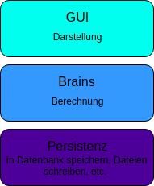

## Notes from Clean Code Tutorial by The Morpheus Tutorials

[Link to playlist](https://www.youtube.com/playlist?list=PLNmsVeXQZj7ryyZikMDPxxyYxEKtKn0ji)

### 1. Introduction
Clean Code are guidelines for clean programming.

#### Why?
- Readable
- Structured
- Short onboarding time
- Better readability for others
- Better maintainability

#### Uncle Bob formatting
The order of attributes and methods matters.
Public attributes should be avoided. Instead, getter and setter methods should be created.

Ideal order:

class Konto {
  public String inhaber:
  private int guthaben;
  public Konto(){...}
  public static ...
  private static ...
  public ueberweisung(...){...}
  public getGuthaben(...){...}
  public setGuthaben(...){...}
}


### 2. Law of Demeter
"Don't talk to Strangers" – meaning don't do something like:

~~int i = getObj().getObj2().getObjA().getSomeOtherObject().getArray()[0];~~

Instead, use `this` to access instance objects.

### 3. Principle of Least Surprise

#### Predictability of Program Flow
What is stated in the method name should also be executed. And not fulfill any other random tasks.

Negative example:


class A {
  private File SomeUnimportantFile;
  File getUnimportantFile(){
    launchNuklearMissile();
    return SomeUnimportantFile;
  }
  launchNuklearMissile(){
    //Destroy Everything!
  }
}


#### Logical Structure
In enumerations, the order should be respected. For weekdays: Monday, Tuesday, etc.
Parts that are not expected should also be omitted; in an enumeration of weekdays, there should be no `"Frei"` (Free).
Even if `"Frei"` is the day you don't work.

Negative example:


enum Date {
  FREITAG, DIENSTAG, MITTWOCH, FREI
}


#### Naming
To pick up the example above again, we have removed the unpredictable execution (`launchNuklearMissile();`).


class A {
  private File SomeUnimportantFile;
  File getUnimportantFile(){
    return SomeUnimportantFile;
  }
  public launchNuklearMissile(){
    //Destroy Everything!
  }
}


But now we notice that `A` and `getUnimportantFile` are not very descriptive; more precise identifiers should be used.

Example:


class Waffenstillstand {
  private File vertrag;
  File getVertrag(){ 
    return vertrag;
  }
  public launchNuklearMissile(){
    //Destroy Everything!
  }
}


Another interesting naming is duplications of the class name and the attribute and method names.

Negative example:


class Konto {
  int kontoname;
}


Here `Konto` appears twice.

Better would be something like:


class Konto {
  int name;
}


### 4. Comments
Too little is too little and too much is too much.

#### Appropriate
  - For hard-to-understand parts of the code.
  - For behavior that affects runtime, for example.
  - Thoughts that take a long time to develop.
  - For Regular Expressions, what they do.
  - Mark TODOs

#### Inappropriate
  - Meaningless, e.g., when a function name is formulated as a sentence.
  - Not for code parts that should be extracted into their own functions.

### 5. DRY: Don't Repeat Yourself
Many errors arise from "Copy" and "Paste".
Replace with procedures/functions.

### 6. YAGNI: You Ain't Gonna Need It
You won't need it.

Negative example:

class Konto {
  public bool ueberweisung(String empfaenger){...}
  public bool indieSchweizueberweisung(String empfaenger){...}
}


The `indieSchweizueberweisung` method could be unnecessary when a bank program first appears.

### 7. SOLID Single Responsibility
One responsibility per class.


class myConnector {
  void connect(){...}
  void terminateConnection(){...}
}


A `send()` and a `receive()` method should be moved to a separate class.


class Communicator{
  void send();
  void receive();
}


Roughly speaking, a class should not contain more than about 200 lines, or around 15 methods.

### 8. SOLID Open-Closed Principle
Open for extension, closed for modification.
It can be extended without being modified.

Negative example:

class Form{...}

for Form f in FormListe{
  switch(typeof(f)){
    case Kreis: f.zeichneKreis();
    case Quadrat: f.zeichneQuadrat();
  }
}


The `switch case` branch would need to be adapted every time this type of implementation appears more often in the codebase, meaning it would have to be changed at every location again. Therefore, the `Form` class should provide a `draw()` method.


class Form{
  zeichne();
}

for Form f in FormList:
  f.draw();


The subclass, e.g., `Kreis`, is then forced to implement a `draw()`.

### 9. SOLID Liskov Substitution Principle
Inheritance that doesn't work:

class Rechteck{
  float breit;
  float hoch;
}

class Quadrat extends Rechteck{
  // hoch === breit
}


Every square is a rectangle, which works in mathematics, but not in a programming sense.
The `Quadrat` class cannot inherit from `Rechteck` because the height is always equal to the width.

The other way around works:

class Quadrat{
  float breit;
  flaeche(){
    return breit * breit
  }
}

class Rechteck extends Quadrat{
  float hoch;
  flaeche(){
    return hoch * breit
  }
}


In this example, the `flaeche()` method still needs to be overridden.

### 10. SOLID Interface Segregation
If inheriting from an interface, it must actually be needed.

Negative example:

interface Worker{
  eat();
  work();
}

class Mensch implements Worker{
  work(){...}
  eat(){...}
}

class Robot implements Worker{
  work(){...}
  eat(){} //<- Too much
}


The `eat()` method is given to the `Robot` class, which then has to override it and leave it empty (dead code).
In this case, two interfaces `Eats` and `Work` would be better.


interface Eats{
  eat();
}

interface Worker {
  work();
}

class Mensch implements Eats, Worker{
  work(){...}
  eat(){...}
}

class Robot implements Worker{
  work(){...}
}


### 11. SOLID Dependency Inversion
In software, we have several layers:

A `CopyPast` interface needs two other classes named `ReadUserInput` and `WriteFile`.
The `CopyPast` is in a very high layer (almost in the GUI layer). The classes `ReadUserInput` and `WriteFile` are in a lower layer (`WriteFile` is in the persistence layer). `CopyPast` depends on the two classes in this case, but the opposite is desired. To achieve this, a class is created that is in a higher layer. In our example, a `Reader` class for `ReadTextInput` and a `Writer` class for `WriteFile`.

### 12. SLA: Single Level of Abstraction
A method should stay at one level of abstraction. This abstraction level should decrease from method to method. The most abstract method calls only methods that are invisible to anyone outside. In these lower methods, the actual computational operations are hidden.

### 13. Refactoring and Pathfinder Rule

#### Pathfinder Rule
You want to leave the code cleaner than you found it.

#### Refactoring

##### Changing Methods
Methods should not change externally.
What to do when a parameter is needed that wasn't there before? Simple solution: use default parameters.

  - Long methods -> Use abstraction levels
  - Duplicate code -> Extract into methods
  - Feature Envy ~~getA().getB().attr~~ -> Extract method
  - Data class (having only data without functions) -> split into classes that also need methods
  - God class (too much at once) -> extract into different classes

##### Test Cases
Only work with test cases, otherwise there is a risk of destroying the code without noticing.

Whenever you no longer understand your own code, you should refactor it.

Tidy up before optimizing for performance.