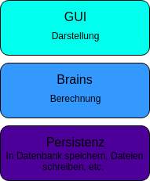

## Mitschriften vom Clean-Code-Tutorial von The Morpheus Tutorials

[Link zur Playlist](https://www.youtube.com/playlist?list=PLNmsVeXQZj7ryyZikMDPxxyYxEKtKn0ji)

### 1. Einführung
Sind Richtlinien für das saubere Programmieren.

#### Warum?
- Leserlich
- Strukturiert
- Kurze Einarbeitungszeit
- Bessere Lesbarkeit für fremde Personen
- Bessere Wartbarkeit

#### Uncle Bob formatting
Die Reihenfolge der Attribute und Methoden ist wichtig.
Es sollte versucht werden, Public Attribute zu vermeiden. Dafür sollten Getter- und Setter-Methoden angelegt werden.

Ideale Reihenfolge:

class Konto {
	public String inhaber:

	private int guthaben;

	public Konto(){...}

	public static ...

	private static ...

	public ueberweisung(...){...}

	public getGuthaben(...){...}
	public setGuthaben(...){...}
}


### 2. Law of Demeter

"Don't talk to Strangers" also, nicht so etwas:

~~int i = getObj().getObj2().getObjA().getSomeOtherObject().getArray()[0];~~

Darum mit ``this`` auf Objekte der Instanz zugreifen.

### 3. Prinzip der kleinsten Überraschung

#### Vorhersehbarkeit von Programmablauf
Das, was im Methodennamen steht, sollte auch ausgeführt werden. Und nicht noch x-beliebige andere Aufgaben erfüllen.

Negativbeispiel:


class A {
	private File SomeUnimportantFile;

	File getUnimportantFile(){
		launchNuklearMissile();
		return SomeUnimportantFile;
	}

	launchNuklearMissile(){
		//Destroy Everything!
	}
}


#### Logischer Aufbau
Also bei Aufzählungen sollte die Reihenfolge beachtet werden. Bei Wochentagen z.B.: Montag, Dienstag ... etc.
Auch Teile, die nicht erwartet werden, sollten weggelassen werden. Bei einer Aufzählung von Wochentagen sollte kein ```"Frei"``` dabei sein.
Auch wenn ```"Frei"``` der Tag ist, wo nicht gearbeitet wird.

Negativbeispiel:


enum Date {
	FREITAG, DIENSTAG, MITTWOCH, FREI
}


#### Namen benennen
Um das Beispiel von oben nochmal aufzugreifen, haben wir jetzt die unvorhersehbare Ausführung (``launchNuklearMissile();``) entfernt.


class A {
	private File SomeUnimportantFile;

	File getUnimportantFile(){
		return SomeUnimportantFile;
	}

	public launchNuklearMissile(){
		//Destroy Everything!
	}
}


Doch jetzt fällt uns auf, dass ``A`` und ``getUnimportantFile`` nicht gerade sehr aussagekräftig sind, hierfür sollten eindeutigere Bezeichner benutzt werden.

Beispiel:


class Waffenstillstand {
	private File vertrag;

	File getVertrag(){ 
		return vertrag;
	}

	public launchNuklearMissile(){
		//Destroy Everything!
	}
}


Weitere interessante Benennungen sind Doppelungen von Namen der Klasse sowie des Attributs und Methoden.

Negativbeispiel:


class Konto {
	int kontoname;

}


Hier ist das `Konto` zweimal drin.

Besser wäre sowas:


class Konto {
	int name;

}


### 4. Kommentare
Zu wenig ist zu wenig und zu viel ist zu viel.

#### Angebracht
 - Bei schwer verständlichen Programmteilen. 
 - Bei Verhalten, wenn es zum Beispiel die Laufzeit betrifft.
 - Gedanken, wenn man für diese lange braucht 
 - Bei Regular Expressions, was diese tun.
 - TODOs kennzeichnen 

#### Unangebracht 
 - Sinnlos z.B. wenn der Name einer Funktion zum Satz formuliert wird 
 - Nicht bei Codeteilen, die als eigene Funktion ausgelagert werden müssten

### 5. DRY: Don't repeat yourself
Viele Fehler entstehen durch "Kopieren" und "Einfügen".
Ersetzen durch Prozeduren/Funktionen.

### 6. YAGNI: You ain't gonna need it 
Du wirst es nicht brauchen.

Negativbeispiel:

class Konto {
	public bool ueberweisung(String empfaenger){...}
	public bool indieSchweizueberweisung(String empfaenger){...}
}


Die Methode ``indieSchweizueberweisung``kann bei dem ersten Erscheinen eines Programms für eine Bank überflüssig sein.

### 7. SOLID Single Responsibility

Eine Verantwortlichkeit pro Klasse.


class myConnector {
	void connect(){...}
	void terminateConnection(){...}
}


Eine ``send()`` sowie eine ``receive()`` Methode müssten in eine separate Klasse ausgelagert werden.


class Communicator{
	void send();
	void receive();
}


Grob kann man sagen, dass eine Klasse nicht mehr als ca. 200 Zeilen beinhalten sollte, oder um die 15 Methoden.

### 8. SOLID Open Closed Prinzip
Open for extension, closed for modification
Es kann erweitert werden, aber es muss dazu nicht verändert werden.

Negativbeispiel:

class Form{...}

for Form f in FormListe{
	switch(typeof(f)){
		case Kreis: f.zeichneKreis();
		case Quadrat: f.zeichneQuadrat();
	}
}


Die ``switch case `` Verzweigung muss jedes Mal neu angepasst werden,
wenn diese Art der Implementierung in der Codebase öfter auftritt, muss das an jeder Stelle noch mal geändert werden. Darum sollte die Klasse ``Form `` eine Methode ``draw()`` zur Verfügung stellen 


class Form{
	zeichne();
}

for Form f in FormList:
	f.draw();


Die Unterklassen, z.B. ``Kreis``, werden dann dazu gezwungen, eine Implementierung von ``draw()`` zu übernehmen.

### 9. SOLID Liskovsches Substitutionsprinzip

Vererbung, die nicht funktioniert:

class Rechteck{
	float breit;
	float hoch;
}

class Quadrat extends Rechteck{
	// hoch === breit
}


Jedes Quadrat ist ein Rechteck, funktioniert in der Mathematik, aber nicht im programmiertechnischen Sinn.
Die Klasse ``Quadrat `` kann nicht von ``Rechteck`` erben, weil die Höhe immer gleich der Breite ist.

Andersherum geht das:
 
class Quadrat{
	float breit;
	
	flaeche(){
		return breit * breit
	}
}

class Rechteck extends Quadrat{
	float hoch;
	
	fläche(){
		return hoch * breit
	}

}


In diesem Beispiel muss die Methode ``flaeche()`` noch überschrieben werden.

### 10. SOLID Interface Segregation
Wenn von einem Interface geerbt wird, muss es auch gebraucht werden.

Negativbeispiel:
 
interface Worker{
	eat();
	work();
}

class Mensch implements Worker{
	work(){...}
	eat(){...}
}

class Robot implements Worker{
	work(){...}
	eat(){} //<- Zuviel
}


Die Methode ``eat()`` wird an die Klasse Robot mitgegeben, dies muss dann überschrieben und leer gelassen werden (toter Code).
Besser wären in diesem Fall zwei Interfaces ``Eats`` und ``Work``.

 
interface Eats{
	eat();
}

interface Worker {
	work();
}

class Mensch implements Eats, Worker{
	work(){...}
	eat(){...}
}

class Robot implements Worker{
	work(){...}
}


### 11. SOLID Dependency Inversion

In Software haben wir mehrere Schichten:



Ein ``CopyPast`` Interface braucht z.B. zwei weitere Klassen namens ``ReadUserInput`` und ``WriteFile``.
Das ``CopyPast`` ist aus einer sehr hohen Schicht (fast in der GUI Schicht). Die Klassen ``ReadUserInput`` und ``WriteFile`` sind in einer niedrigeren Schicht (``WriteFile`` ist in der Persistenz Schicht). ``CopyPast`` hängt in diesem Fall von den beiden Klassen ab, jedoch möchte man das Umgekehrte erreichen. Um das zu bewerkstelligen, wird nun eine Klasse erstellt, die sich in einer höheren Schicht befindet. In unserem Beispiel eine ``Reader`` Klasse für ``ReadTextInput`` und eine ``Writer`` Klasse für ``WriteFile``.

### 12. SLA: Single Level of Abstraction

Eine Methode hat eine Abstraktionsebene, in der geblieben werden soll. Diese Abstraktionsebene sollte von Methode zu Methode abnehmen. Die abstrakteste Methode ruft nur Methoden auf, die von außen für niemanden sichtbar sind. In diesen unteren Methoden verbergen sich dann die eigentlichen Rechenoperationen.

### 13. Refactoring und Pfadfinderregel

#### Pfadfinderregel
Man möchte den Code immer sauberer verlassen, als man ihn vorgefunden hat.

#### Refactoring

##### Methoden verändern
Nach außen sollen sich Methoden nicht ändern.
Was tun, wenn ein Parameter gebraucht wird, den es vorher nicht gab? Einfache Lösung: Default-Parameter einsetzen.

 - Lange Methoden -> Verwenden von Abstraktionsebenen
 - Doppelten Code -> Auslagern in Methoden
 - Feature Envy ~~getA().getB().attr~~ -> Methode extrahieren 
 - Data Klasse (Haben nur Daten ohne Funktionen) -> aufteilen in Klassen, die dann auch Methoden brauchen.
 - Gott Klasse (viel zu viel auf einmal) -> auslagern in verschiedene Klassen

##### Testfälle
Nur mit Testfällen bearbeiten, sonst besteht die Gefahr, den Code zu zerstören, ohne es mitzubekommen.

Immer wenn du deinen eigenen Code nicht mehr verstehst, solltest du ihn überarbeiten.

Ordentlichkeit vor Performance: erst aufräumen, dann schnell machen.
