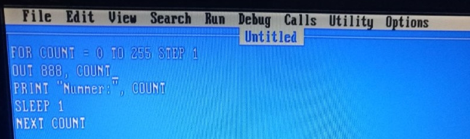
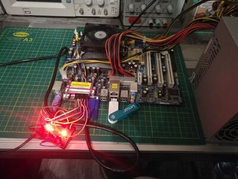
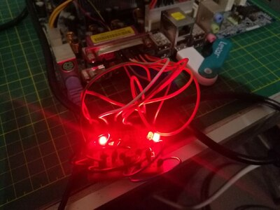
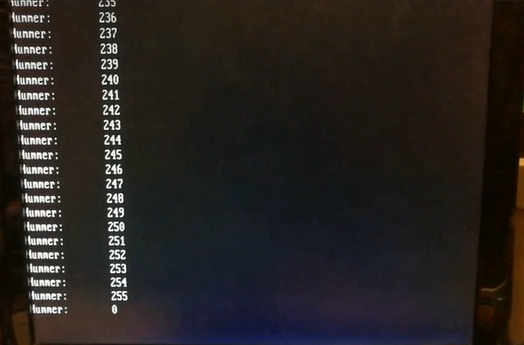

FreeDOS ist ein Open-Source-Betriebssystem, das Kompatibilität mit MS-DOS herstellen soll.
Es wurde hauptsächlich entwickelt, um alte Programme und Spiele auf moderner Hardware zum Laufen zu bringen.
Besonders interessant ist es, in die Vergangenheit der Betriebssysteme zu schauen und zu merken,
wie viele Mechanismen, die wir heute als selbstverständlich erachten, damals einfach nicht existierten.

Hierbei rede ich nicht einmal von grafischen Benutzeroberflächen,
sondern von grundlegenden Sicherheitsprinzipien. 
Zum Beispiel existiert bei DOS-Systemen keine Trennung von Kernel- und Userspace, wie sie in modernen Betriebssystemen üblich ist.
Diese Trennung, auch als Privilegienstufen oder Ringarchitektur bekannt, schützt moderne Systeme vor schädlichen Zugriffen und sorgt für Stabilität.

## Was sind Privilegienstufen?

Moderne Betriebssysteme verwenden eine sogenannte Ringarchitektur, die unterschiedliche Privilegienstufen für die Ausführung von Code definiert.
Diese Ringe reichen von Ring 0 (Kernel-Mode) bis zu Ring 3 (User-Mode):

- **Ring 0** (Kernel-Mode): Hier läuft der Betriebssystemkernel, der direkten Zugriff auf die Hardware hat.
Programme in diesem Modus können alles auf dem System steuern, weshalb sie besonders gut abgesichert sein müssen.
- **Ring 3** (User-Mode): Hier laufen gewöhnliche Programme und Anwendungen.
Sie haben keinen direkten Zugriff auf die Hardware, sondern müssen Anfragen über den Kernel stellen.
Dadurch wird die Sicherheit des Systems erhöht.

Im Gegensatz dazu läuft bei FreeDOS alles ohne diese Trennung.
Jeder Prozess kann direkt auf die Hardware zugreifen, was zwar flexibel ist, aber auch Sicherheitsrisiken birgt.

## QBasic und der Parallelport

Ein interessantes Beispiel dafür, wie einfach es früher war, auf die Hardware zuzugreifen,
ist der Umgang mit dem Parallelport.
Ich habe ein cooles [YouTube Video](https://www.youtube.com/watch?v=7D-JES4BnTw) gefunden, das zeigt,
wie man mit einfachem QBasic den Parallelport steuern kann.

Heutzutage wäre es undenkbar, ohne spezielle Berechtigungen oder Treiber direkt auf die Hardware zuzugreifen.
Doch bei FreeDOS ist das ganz einfach.

Hier eine Anleitung, wie du mit FreeDOS und QBasic den Parallelport steuern kannst:

1. Mit Rufus FreeDOS auf einen USB-Stick kopieren.
2. [QBasic](https://www.qbasic.net/de/qbasic-downloads/compiler/qbasic-compiler.htm) (Version 7.1) herunterladen und auf den Stick packen.
3. Das Zielsystem vom USB-Stick booten.
4. Ins QBasic-Verzeichnis wechseln: `cd bin`
5. QBasic starten: `qbx`

Hier ein kleines Programm, das von 1 bis 255 zählt und die Zahl sowohl auf dem Bildschirm
als auch über den Parallelport in binärer Form ausgibt:


FOR COUNT = 0 TO 255 STEP 1
OUT 888, COUNT
PRINT "Number: ", COUNT
SLEEP 1
NEXT COUNT


Die `888` steht für den Parallelport.
Der Aufbau sieht so aus: Jumper verbinden die Datenleitungen des Parallelports mit dem positiven Ende einer LED. 
Alle LEDs sind mit `GND` vom Parallelport verbunden.

Hier zwei Fotos des Aufbaus:

 | 

Und hier ein kurzes Video, das den Zählvorgang zeigt:

