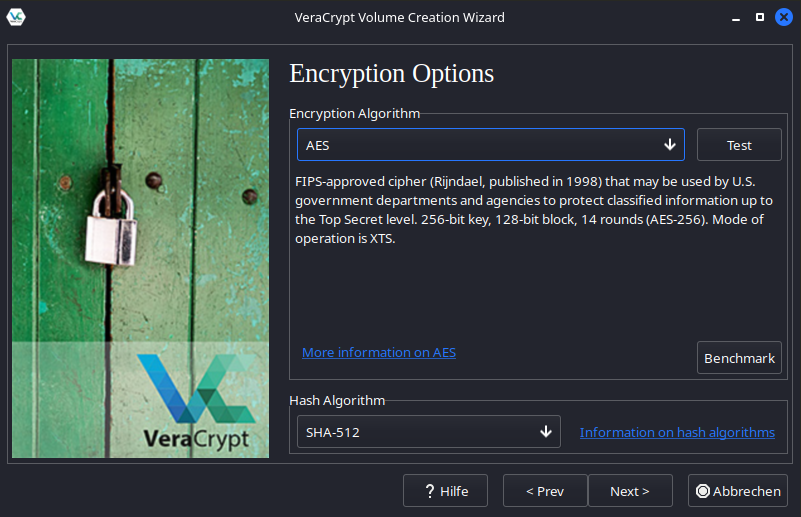
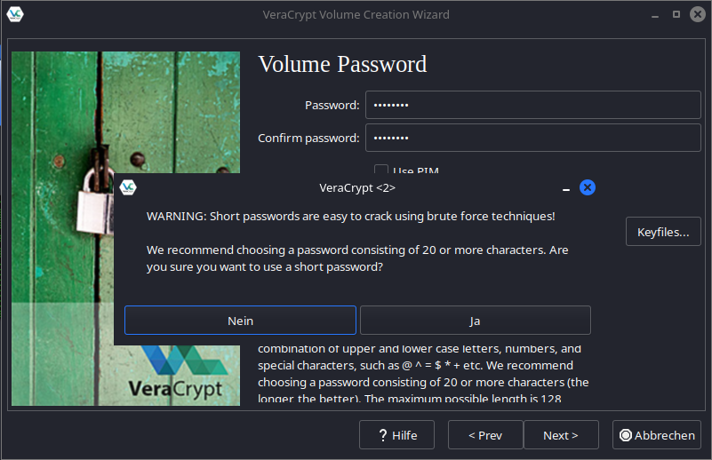

In diesem Beitrag möchte ich über das Knacken von VeraCrypt-Passwörtern mit Hashcat sprechen.
Hashcat ist ein leistungsstarkes Tool zum Cracken von Passwörtern.
Oft wird das Cracken von MD5-Hashes behandelt, aber heute werfen wir einen Blick auf VeraCrypt.
Es geht dabei nicht um das Angreifen der Verschlüsselung selbst,
sondern um das Ausnutzen schwacher Passwörter – ein häufiges Problem.

## Ziel 🎯

Zunächst erstellen wir einen VeraCrypt-File-Container.
Die Verschlüsselungsmethode wird auf AES belassen,
und als Hash-Algorithmus verwenden wir SHA-512 – beides Standardwerte bei VeraCrypt.

Nun kommt der entscheidende Punkt: Wir wählen absichtlich ein schwaches Passwort.
VeraCrypt warnt uns zu Recht, dass dieses anfällig für Brute-Force-Angriffe ist.

## Kurze Theorie 👨‍🏫

Ein Hash ist eine sogenannte Einwegfunktion: Man gibt einen Wert hinein und erhält eine bestimmte Ausgabe, den Hash.
Der Clou ist, dass es praktisch unmöglich ist, aus dem Hash direkt auf den ursprünglichen Wert zu schließen – so wie man aus einem fertigen Gericht nicht mehr auf die genaue Menge der Zutaten zurückkommen kann.
Allerdings gibt es eine Methode, um das ursprüngliche Passwort zu finden: Man kann verschiedene Eingaben in die Hashfunktion füttern und die Ausgaben mit dem vorliegenden Hash vergleichen. Dieser Ansatz ist das Herzstück des Passwort-Crackings.

## Angriff auf das Ziel 🏹

### Hash Types

Hashcat unterstützt eine Vielzahl von Hash-Typen.
Eine komplette Liste kann man sich mit `hashcat --help` anzeigen lassen.
Diese Typen wählt man mit dem Parameter `-m` (Modi) bzw. `--hash-type` aus.
MD5 ist sehr verbreitet und hat die Nummer 0. 
Für unseren Fall, VeraCrypt mit AES und SHA-512, verwenden wir den Modus 13722.

### Attack Mode

Hashcat bietet verschiedene Angriffsmethoden, die man mit dem Parameter `-a` bzw. `--attack-mode` steuert.
Ich habe zwei Methoden ausprobiert: Wörterbuch-Angriffe und Brute-Force-Angriffe.
Es gibt noch weitere, wie zum Beispiel die Kombination von Wörterbuch-Angriffen mit Regeln (etwa: "Am Ende muss ein Sonderzeichen stehen").

#### Wörterbuch-Attacken 📖

Ein Wörterbuch-Angriff basiert auf einer Liste von potenziellen Passwörtern, die der Angreifer durchprobiert.
In Kali Linux gibt es viele solcher Listen, die bekannteste ist `rockyou.txt`, die aus realen Passwort-Leaks stammt und häufig genutzte Passwörter enthält.

Es gibt auch Tools, um eigene Wörterlisten zu erstellen. Drei davon möchte ich kurz vorstellen:

1. `Crunch`: Mit diesem Tool kann man definieren, wie die Wortliste aussehen soll – etwa die Länge der Passwörter und welche Zeichen enthalten sein sollen.

2. `Cewl`: Dieses [Tool](https://github.com/digininja/CeWL) durchsucht Webseiten und generiert daraus Wortlisten. Clever, denn manche Firmen nutzen tatsächlich Begriffe wie ihren Firmennamen als Passwort. 🤔

3. `cupp`: Der [Common User Password Profiler](https://github.com/Mebus/cupp) generiert individuelle Wörterlisten auf Basis persönlicher Informationen (wie Geburtsdatum, Namen von Haustieren oder Kindern).

Jetzt zur eigentlichen Attacke mit Hashcat:

`hashcat -a 0 -m 13722 test rockyou.txt  -o cracked.txt`

- `-a 0` steht für den Wörterbuch-Angriff.
- `test` ist der verschlüsselte VeraCrypt-Container.
- `rockyou.txt` ist die verwendete Wörterliste.
- `-o` gibt den Output an, in diesem Fall wird das geknackte Passwort in cracked.txt gespeichert.

#### Brute-force 👊

Ein Brute-Force-Angriff testet systematisch alle möglichen Passwortkombinationen.
Diese Methode ist extrem rechenintensiv und meistens nicht erfolgreich, es sei denn, das Passwort ist sehr kurz.

Es ist das rabiate Ausprobieren aller möglichen Zeichenkombinationen.
Diese Attacke ist natürlich rechenintensiver und wird in einem echten Fall wohl nicht von Erfolg gekrönt sein.

`hashcat -a 3 -m 13722 test ?l?l?l?l?l --increment --increment-min 5`

- `-a 3` steht für den Brute-Force-Angriff.
- Die `?l?l?l?l?l` geben an, dass Kleinbuchstaben getestet werden sollen.
- Mit `--increment` wird die Passwortlänge schrittweise erhöht, beginnend bei 5 Zeichen.

### Zeit 🕜

Ich habe für meine Tests eine inzwischen etwas in die Jahre gekommene GTX 1060 verwendet.
Beim Passwort-Cracking gilt: Je mehr Rechenleistung, desto besser.
Bei meinem Test erreichte ich 168 Hashes/s mit dem Brute-Force-Angriff und 245 Hashes/s beim Wörterbuch-Angriff – ziemlich wenig im Vergleich zu den tausenden Mega-Hashes/s, die man beim Knacken von MD5 erreicht.
