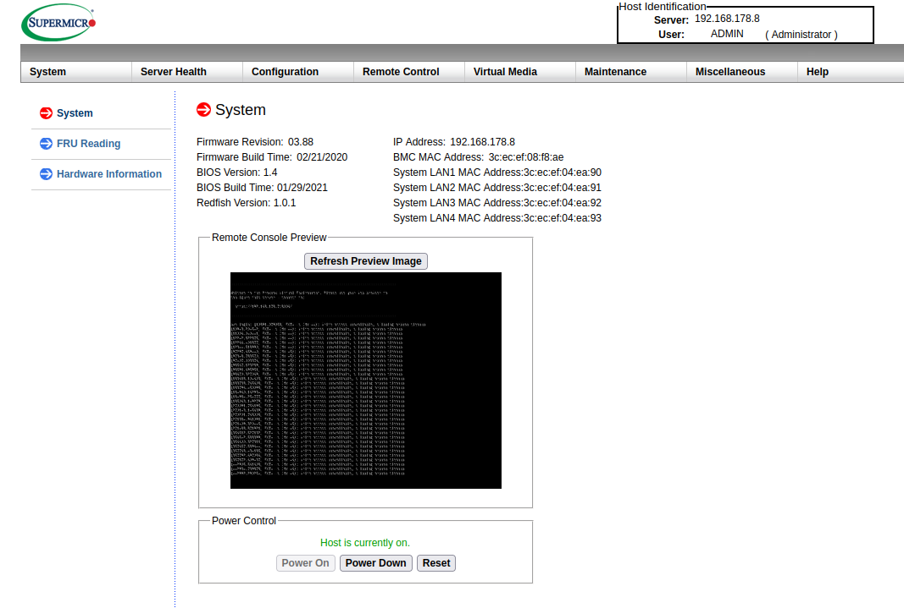
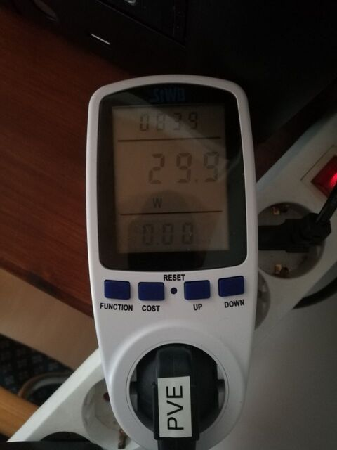

I want to describe the hardware of my home lab here.

Disclaimer: may contain traces of unpaid advertising

## Getting Started! ⏳

But what is more important is, if you have an interest in the Home Lab topic, just get started and don't waste time.
It doesn't matter at first what hardware you start with; you will most likely adjust it again once you realize what your needs are.
I myself started with an old used Dell Optiplex 755 from Ebay. (Admittedly perhaps not the best choice)
You don't have to wait until you can afford all that expensive hardware.

## Motherboard

For the motherboard I decided on a [Supermicro A2SDi-4C-HLN4F](https://www.supermicro.com/en/products/motherboard/A2SDi-4C-HLN4F).
Price-wise it wasn't a bargain, but I also bought it at a time when everything was expensive anyway.
The CPU is built into the motherboard and cannot be removed or replaced. The CPU is an Intel Atom C3558 and therefore an x86_64 architecture.
Admittedly, with 2.2GHz and 4 cores it is quite weak. But my experience has shown that it is completely sufficient for me.
Of course, this also depends on the services and number of users.

## RAM

In my setup, I also found that I always need just over 8GB.
That's why I chose 16GB ECC RAM, so there's still enough room for all sorts of tinkering.

### ECC

It stands for Error Correction Code, with every break in a computer errors can occur, one speaks of bits simply flipping (Bit-Flip).
To avoid these errors, there is this technology called ECC. The basic idea is to generate a parity bit from a number of bits; when an error is detected during checking, the error can be found and corrected. This happens during operation, so neither crashes nor data loss can occur.

How do I know if I have ECC RAM installed?
Under Linux, the following command can be used:


# dmidecode 3.3

$ dmidecode --type 16
Getting SMBIOS data from sysfs.
SMBIOS 3.0.0 present.

Handle 0x0017, DMI type 16, 23 bytes
Physical Memory Array
Location: System Board Or Motherboard
Use: System Memory
Error Correction Type: Single-bit ECC
Maximum Capacity: 128 GB
Error Information Handle: Not Provided
Number Of Devices: 4


Do I need ECC RAM?

From my experience, installing ECC RAM only makes sense when building servers. My gut feeling would also say it's a bit overkill for private use. 🤓

## Ethernet Ports

The board has 4 Gigabit ports. These allow testing some network configurations.
Meaning testing VLANs, link aggregation, or forwarding one port to a specific VM/container. As well as setting up a firewall.

## IPMI

What is IPMI?

The term stands for Intelligent Platform Management Interface, it enables remote maintenance of the computer that takes place outside the operating system.
A kind of BIOS, except you can control the computer through the network. This works even when the computer is off.
This management system has different names at different manufacturers; Dell calls it iDRAC, HP calls it iLO.

Here is a picture of my Supermicro IPMI:

In a business context, it is important to separate this from the normal network.
Because vulnerabilities in these remote maintenance systems keep coming up, most recently in [HP's iLO](https://www.heise.de/news/Rootkit-schluepft-durch-Luecke-in-HPEs-Fernwartung-iLO-6315714.html).

## Noise 🔈

Noise is of course often an issue at home; the motherboard itself has no fan built in.
I replaced the power supply fan with a Noctua 40x20mm fan.
Noctua fans have a reputation for being particularly quiet, and I must say that I am quite satisfied.

Since the CPU temperature was still quite high, I installed a 120mm Noctua fan in the case.

By the way, the case 🧐

## Case

I use an [INTER-TECH IPC SC-4004](https://www.amazon.de/INTER-TECH-IPC-SC-4004-HDD-EXT/dp/B01GZ1S7YI?__mk_de_DE=%C3%85M%C3%85%C5%BD%C3%95%C3%91&dchild=1&keywords=inter-tech+ipc+sc-4004&qid=1612880770&s=computers&sr=1-1&linkCode=sl1&tag=austriangamer-21&linkId=8b18d316b1dfa6ce39d1c28a95147ec7&language=de_DE&ref_=as_li_ss_tl).
The general build quality is quite poor, but what I like is that it offers the possibility to accommodate four 3.5-inch hard drives. These could also be swapped in Hot Plug mode.
I currently only use two of them, which brings me to the next topic.

## Storage 💾

I have two SSDs installed in my system, one with 120 GB, which houses the basic operating system.
The second has one terabyte, where all VMs/Containers are stored.

Interesting command to list drives:


$ lshw -class disk -short
H/W path Device Class Description
=======================================================
/0/100/14/0 /dev/sda disk 1TB Samsung SSD 870
/0/100/14/1 /dev/sdb disk 120GB KINGSTON SV300S3


## No Spinning Disks 💿

I opted out of classic hard drives in the hope that the system would consume less energy, which brings us to the next topic.

## Power ⚡

Unfortunately a big topic in Germany; even Hetzner has raised its prices because electricity prices have gone up. [Golem Article](https://www.golem.de/news/hosting-hetzner-erhoeht-preise-teils-um-30-prozent-wegen-stromkosten-2201-162685.html)

At home too, these are costs that cannot be ignored.

I plugged a measuring device into my server:

I get an average consumption of about 30 watts.
If you put this into a [power calculator](https://rechneronline.de/steckdose/stromkosten.php), you get about 80€ per year in costs.

## Interesting Hardware

Here are some computers that caught my eye as a beginner:

- [Minisforum PCs](https://store.minisforum.de/)
- [Intel Nuc](https://www.intel.de/content/www/de/de/products/details/nuc.html)
- [Mini PC from Amazon](https://www.amazon.de/dp/B089SHG28D/ref=cm_sw_r_oth_api_glt_i_SHYRM4DDHAQPEYV6RF8V?psc=1)