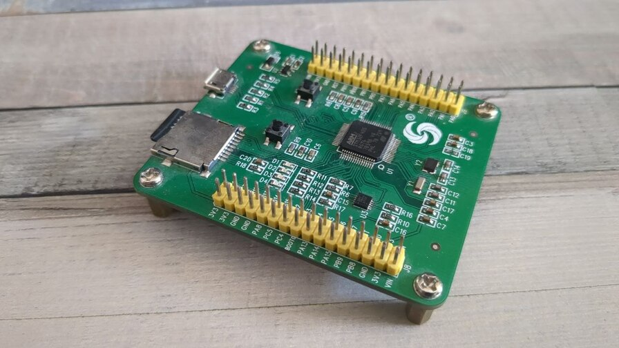
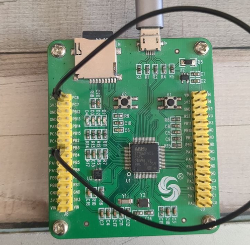

Hello, in this post it's about flashing MicroPython firmware onto a China clone of the PyBoard. It is a clone with the STM32F405RGT6 chip.

Today, probably very few people still use this board. ESP32 and RP2040 are far more well-known competitors here.
But for people like me who own the board and wonder how to flash new firmware onto the chip, I have created a short how-to.

The hardware:

To flash the firmware, we need:

- The PyBoard Clone
- A MicroUSB cable
- Jumper wires to short the boot pin

To be able to flash firmware at all, we need the program `dfu-util`. This is already available in the package repositories of many Linux distributions. It can be installed simply with `sudo apt install dfu-util`.

Now we need to bring the board into the so-called bootloader mode. For this, the two boot pins must be shorted. Jumper wires or a piece of wire are suitable for this. BOOT0 must be connected to 3.3V.

Now connect the board to our PC via USB. `dfu-util` should be able to detect the board.

Now we can save the firmware on the board. (I would definitely do this, I have already needed this backup).


sudo dfu-util --alt 0 --upload pyboard-original.dat -s:524288


In case you need to restore the backup:


$ sudo dfu-util --alt 0 -D pyboard-original.dat -d 0483:df11 -s 0x8000000


Since the firmware is not available for our board on the MicroPython website,
we have to compile it ourselves.
For this we need `git`, `make` and `arm-none-eabi-gcc`.


sudo apt install git build-essential gcc-arm-none-eabi \
    libnewlib-arm-none-eabi \
    make python3 python3-pip \
    cmake ninja-build


Now the Micropython Git repository needs to be downloaded.


git clone https://github.com/micropython/micropython
cd micropython
git submodule update --init --recursive


Now `mpy-cross` needs to be compiled. This is used to translate Python code into machine code.


cd mpy-cross
make
cd ..


Now the submodules from Ports/STM32 need to be downloaded. For this we need to change to the ports/stm32 directory.


cd ports/stm32
make submodules


Now we still need to compile the firmware. For this we use the command `make BOARD=PYBV3`. PYBV3 is the board type.


make BOARD=PYBV3


Afterwards, the firmware is located in the directory `micropython/ports/stm32/build-PYBV3/firmware.dfu`. This can now be flashed again.


sudo dfu-util --alt 0 -D firmware.dfu


Our board now has the latest MicroPython version running.