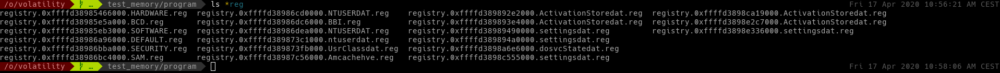
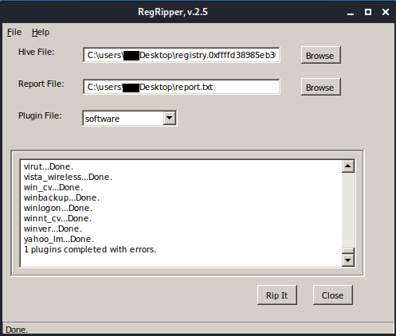
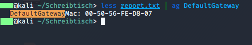
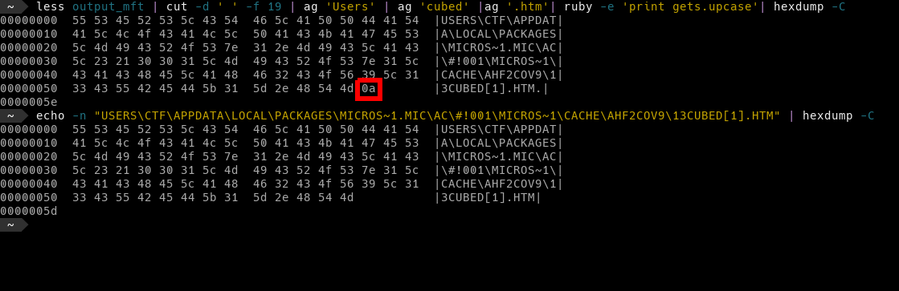
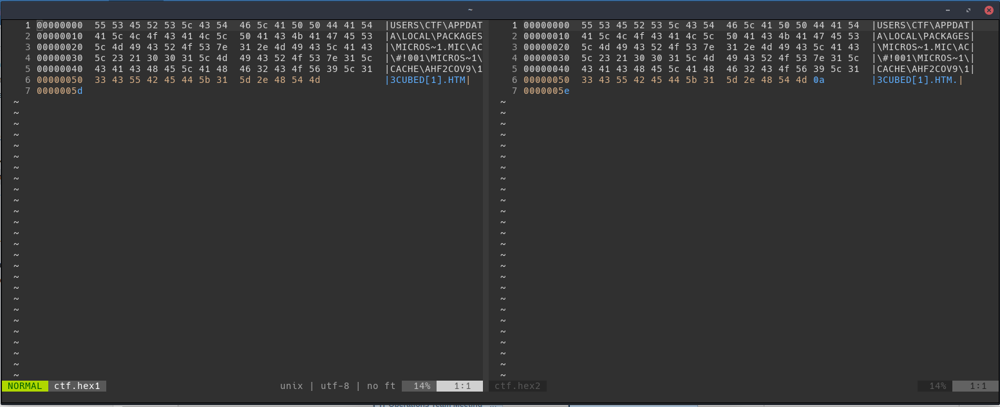

CTF stands for Capture the Flag, the goal of the game is to get all the flags, the CTF consisted of a Memory File and 4
questions/tasks that served as flags.

The Mini Memory CTF comes from the YouTuber 13Cube, the idea is to learn
how to use volatility or other memory analysis tools in a game-like
way.

[Link to announcement video](https://www.youtube.com/watch?v=JuEv8UleO0U&t=)

[Tasks and solutions of the CTF](img/mini_memory_ctf_solutions_guide.pdf)

#### Flag Number 1:

Which running process is malicious? Name the MD5 Hash of the
process ID.

The ubiquitous Windows svchost.exe is a popular process to
hide malware in. A normal system has many of these
`svchost.exe` processes running. This is always a child process of
services.exe and is located in the directory: %SYSTEMROOT% System32.

First, we run this command: `vol -f /opt/volatility/test_memory/ctf/memdump.mem --profile=Win10x64_15063 psscan | grep -i svchost`

The profile Win10x64_15063 is used, and we use the `psscan` plugin, which is similar to `pslist`. However, `psscan`
also reveals processes running in the background. We also filter for svchost.


    Volatility Foundation Volatility Framework 2.6.1
    0x0000a780001d6080 svchost.exe        5048    804 0x000000003c400002 2018-08-01 19:21:00 UTC+0000
    0x0000c20c6a5514c0 svchost.exe        8808    804 0x0000000079000002 2018-08-06 18:12:05 UTC+0000
    0x0000c20c6aa0d580 svchost.exe        8052    804 0x00000000a5c09002 2018-08-06 18:12:40 UTC+0000
    0x0000c20c6aaf9080 svchost.exe        1992    804 0x0000000006500002 2018-08-06 18:12:01 UTC+0000
    0x0000c20c6ab2b580 svchost.exe.ex     6176   4824 0x000000004d100002 2018-08-01 19:52:19 UTC+0000   2018-08-01 19:52:19 UTC+0000
    0x0000c20c6ab70080 svchost.exe        8852   4824 0x0000000096f00002 2018-08-01 19:59:49 UTC+0000   2018-08-01 20:00:08 UTC+0000
    0x0000c20c6b4c6080 svchost.exe        5048    804 0x000000003c400002 2018-08-01 19:21:00 UTC+0000
    0x0000c20c6b513580 svchost.exe        5264    804 0x00000000b8950002 2018-08-01 19:21:11 UTC+0000
    0x0000c20c6b585580 svchost.exe        3224    804 0x0000000078e00002 2018-08-01 19:43:30 UTC+0000
    0x0000c20c6b5b6580 svchost.exe        4040    804 0x00000000b9770002 2018-08-01 19:21:04 UTC+0000
    0x0000c20c6b6a5580 svchost.exe        2020    804 0x0000000023b00002 2018-08-01 19:20:54 UTC+0000
    0x0000c20c6b6b5580 svchost.exe        4304    804 0x000000002d400002 2018-08-01 19:20:55 UTC+0000
    0x0000c20c6b6c3580 svchost.exe        4132    804 0x0000000028b00002 2018-08-01 19:20:54 UTC+0000
    0x0000c20c6b8dd580 svchost.exe         924    804 0x000000010e410002 2018-08-01 19:20:28 UTC+0000
    0x0000c20c6b8df580 svchost.exe         904    804 0x000000010ba10002 2018-08-01 19:20:28 UTC+0000
    0x0000c20c6ba17580 svchost.exe         628    804 0x0000000110d10002 2018-08-01 19:20:28 UTC+0000
    0x0000c20c6ba39580 svchost.exe        1020    804 0x0000000110930002 2018-08-01 19:20:28 UTC+0000
    0x0000c20c6ba9f080 svchost.exe         476    804 0x0000000112620002 2018-08-01 19:20:29 UTC+0000
    0x0000c20c6bad9580 svchost.exe        1196    804 0x0000000111f20002 2018-08-01 19:20:29 UTC+0000
    0x0000c20c6bae1580 svchost.exe        1072    804 0x0000000110f20002 2018-08-01 19:20:29 UTC+0000
    0x0000c20c6bae3580 svchost.exe        1056    804 0x0000000112ed0002 2018-08-01 19:20:29 UTC+0000
    0x0000c20c6bae5580 svchost.exe        1040    804 0x0000000112f00002 2018-08-01 19:20:29 UTC+0000
    0x0000c20c6bae9580 svchost.exe         800    804 0x0000000112610002 2018-08-01 19:20:29 UTC+0000   2018-08-06 18:11:48 UTC+0000
    0x0000c20c6bb8e580 svchost.exe        1296    804 0x0000000113180002 2018-08-01 19:20:30 UTC+0000
    0x0000c20c6bb9a580 svchost.exe        1392    804 0x0000000116a50002 2018-08-01 19:20:30 UTC+0000
    0x0000c20c6bb9c580 svchost.exe        1384    804 0x0000000116b20002 2018-08-01 19:20:30 UTC+0000
    0x0000c20c6bbf2580 svchost.exe        1480    804 0x0000000115ba0002 2018-08-01 19:20:30 UTC+0000
    0x0000c20c6bbf4580 svchost.exe        1472    804 0x0000000115b70002 2018-08-01 19:20:30 UTC+0000
    0x0000c20c6bc35580 svchost.exe        1632    804 0x00000001169d0002 2018-08-01 19:20:30 UTC+0000
    0x0000c20c6bc3b580 svchost.exe        1600    804 0x0000000116910002 2018-08-01 19:20:30 UTC+0000
    0x0000c20c6bc3d580 svchost.exe        1592    804 0x00000001189c0002 2018-08-01 19:20:30 UTC+0000
    0x0000c20c6bc3f580 svchost.exe        1576    804 0x0000000118960002 2018-08-01 19:20:30 UTC+0000
    0x0000c20c6bc41580 svchost.exe        1568    804 0x0000000118810002 2018-08-01 19:20:30 UTC+0000
    0x0000c20c6bca52c0 svchost.exe        1608    804 0x0000000116930002 2018-08-01 19:20:30 UTC+0000
    0x0000c20c6bcc9580 svchost.exe        1692    804 0x0000000119160002 2018-08-01 19:20:31 UTC+0000
    0x0000c20c6bcd1400 svchost.exe        2888    804 0x0000000097500002 2018-08-01 19:24:32 UTC+0000   2018-08-01 19:24:38 UTC+0000


We can see that the majority of processes have PID 804 as their parent process, which is also completely fine. If we look a little closer, we find out that this is the service.exe. But what about the process with PID 4824?

Let's grep for 4824: `vol -f /opt/volatility/test_memory/ctf/memdump.mem --profile=Win10x64_15063 psscan | grep -i 4824`


    Volatility Foundation Volatility Framework 2.6.1
    0x0000c20c69cfe580 explorer.exe       4824   4756 0x0000000035800002 2018-08-01 19:20:58 UTC+0000
    0x0000c20c6a959580 FTK Imager.exe     3328   4824 0x000000005dd00002 2018-08-06 18:13:14 UTC+0000
    0x0000c20c6ab2b580 svchost.exe.ex     6176   4824 0x000000004d100002 2018-08-01 19:52:19 UTC+0000   2018-08-01 19:52:19 UTC+0000
    0x0000c20c6ab70080 svchost.exe        8852   4824 0x0000000096f00002 2018-08-01 19:59:49 UTC+0000   2018-08-01 20:00:08 UTC+0000
    0x0000c20c6ab92580 ByteCodeGenera     6532   4824 0x000000004c200002 2018-08-01 19:50:42 UTC+0000   2018-08-01 19:50:42 UTC+0000
    0x0000c20c6abeb580 notepad.exe        1412   4824 0x0000000056000002 2018-08-06 18:12:15 UTC+0000   2018-08-06 18:12:17 UTC+0000
    0x0000c20c6b588580 ie4uinit.exe       5716   4824 0x00000000bc500002 2018-08-01 19:21:30 UTC+0000   2018-08-01 19:21:31 UTC+0000
    0x0000c20c6c095580 MSASCuiL.exe       6268   4824 0x000000009ad00002 2018-08-01 19:21:56 UTC+0000
    0x0000c20c6cdf4580 scvhost.exe         360   4824 0x000000006af00002 2018-08-01 19:56:45 UTC+0000   2018-08-06 18:12:03 UTC+0000
    0x0000c20c6cfb1580 OneDrive.exe       2200   4824 0x00000000ba600002 2018-08-01 19:22:10 UTC+0000
    0x0000c20c6cfc2580 vmtoolsd.exe       3372   4824 0x0000000097700002 2018-08-01 19:21:56 UTC+0000
    0x0000c20c6d0d2080 Bubbles.scr       10204   4824 0x0000000047700002 2018-08-01 19:50:33 UTC+0000   2018-08-01 19:50:38 UTC+0000
    0x0000c20c6d36c080 scvhost.exe.ex      336   4824 0x000000004a100002 2018-08-01 19:52:31 UTC+0000   2018-08-01 19:52:31 UTC+0000
    0x0000c20c6d4d2080 dxdiag.exe         6324   4824 0x00000000a1900002 2018-08-01 19:51:18 UTC+0000   2018-08-01 19:51:28 UTC+0000
    0x0000c20c6d510080 notepad - Copy     6372   4824 0x0000000109000002 2018-08-01 20:10:32 UTC+0000   2018-08-01 20:10:32 UTC+0000
    0x0000c20c6d5ac340 svchost.exe.ex     5528   4824 0x0000000119400002 2018-08-01 19:52:20 UTC+0000   2018-08-01 19:52:20 UTC+0000
    0x0000c20c6d694080 notepad - Copy     3504   4824 0x000000001ea00002 2018-08-01 20:10:37 UTC+0000   2018-08-01 20:10:37 UTC+0000
    0x0000c20c6d6fc580 svchost.exe       10012   4824 0x0000000136200002 2018-08-01 19:49:19 UTC+0000   2018-08-01 19:49:19 UTC+0000
    0x0000c20c6d732080 notepad.exe        9128   4824 0x0000000069500002 2018-08-01 20:05:10 UTC+0000   2018-08-01 20:05:12 UTC+0000
    0x0000c20c6d789580 Bubbles.scr        6948   4824 0x000000011d400002 2018-08-01 19:50:30 UTC+0000   2018-08-01 19:50:31 UTC+0000
    0x0000c20c6d82e080 svchost.exe        1404   4824 0x00000000a0f00002 2018-08-01 19:54:55 UTC+0000   2018-08-01 19:56:35 UTC+0000
    0x0000c20c6d86b080 cmd.exe            3884   4824 0x0000000047100002 2018-08-01 19:37:47 UTC+0000
    0x0000c20c6d99b580 svchost.exe.ex     8140   4824 0x00000000b8600002 2018-08-01 19:52:16 UTC+0000   2018-08-01 19:52:16 UTC+0000
    0x0000c20c6daf9580 notepad.exe        7968   4824 0x000000001bb00002 2018-08-01 19:57:10 UTC+0000   2018-08-01 19:57:10 UTC+0000
    0x0000c20c6dbc5340 svchost.exe        7852   4824 0x000000003ff00002 2018-08-01 19:49:21 UTC+0000   2018-08-01 19:49:22 UTC+0000
    0x0000c20c6ddad580 svchost.exe        8560   4824 0x00000000b2200002 2018-08-01 20:13:10 UTC+0000
    0x0000c20c6e0bf580 scvhost.exe.ex     3016   4824 0x0000000137f00002 2018-08-01 19:52:29 UTC+0000   2018-08-01 19:52:29 UTC+0000
    0x0000c20c6e24f580 xwizard.exe         252   4824 0x000000010be00002 2018-08-01 19:51:52 UTC+0000   2018-08-01 19:51:55 UTC+0000
    0x0000c20c6e495080 cmd.exe            8868   4824 0x000000005ff00002 2018-08-01 19:40:14 UTC+0000   2018-08-01 19:49:18 UTC+0000
    0x0000c20c6e5ca200 notepad.exe        8800   4824 0x0000000024400002 2018-08-01 20:10:19 UTC+0000   2018-08-01 20:10:21 UTC+0000


Right in the first line we see that 4824 is the `explorer.exe`, but this process does not have the task of running a svchost.exe.

Now we search for 4824 and svchost: `vol -f /opt/volatility/test_memory/ctf/memdump.mem --profile=Win10x64_15063 psscan | grep -i 4824 | grep svchost`


    Volatility Foundation Volatility Framework 2.6.1
    0x0000c20c6ab2b580 svchost.exe.ex     6176   4824 0x000000004d100002 2018-08-01 19:52:19 UTC+0000   2018-08-01 19:52:19 UTC+0000
    0x0000c20c6ab70080 svchost.exe        8852   4824 0x0000000096f00002 2018-08-01 19:59:49 UTC+0000   2018-08-01 20:00:08 UTC+0000
    0x0000c20c6d5ac340 svchost.exe.ex     5528   4824 0x0000000119400002 2018-08-01 19:52:20 UTC+0000   2018-08-01 19:52:20 UTC+0000
    0x0000c20c6d6fc580 svchost.exe       10012   4824 0x0000000136200002 2018-08-01 19:49:19 UTC+0000   2018-08-01 19:49:19 UTC+0000
    0x0000c20c6d82e080 svchost.exe        1404   4824 0x00000000a0f00002 2018-08-01 19:54:55 UTC+0000   2018-08-01 19:56:35 UTC+0000
    0x0000c20c6d99b580 svchost.exe.ex     8140   4824 0x00000000b8600002 2018-08-01 19:52:16 UTC+0000   2018-08-01 19:52:16 UTC+0000
    0x0000c20c6dbc5340 svchost.exe        7852   4824 0x000000003ff00002 2018-08-01 19:49:21 UTC+0000   2018-08-01 19:49:22 UTC+0000
    0x0000c20c6ddad580 svchost.exe        8560   4824 0x00000000b2200002 2018-08-01 20:13:10 UTC+0000


In the last column we see when the processes last ran, and only the last one is still in memory. The process we are looking for has the PID of 8560. Quickly form the MD5 value and
we're done. `echo -n "8560" | md5sum`

The first flag is `bc05ca60f2f0d67d0525f41d1d8f8717`.

#### Flag Number 2:

Find the malicious process and dump its memory. In it you will find a 32-character long flag.

Create a memory dump of the process with this command: `vol -f /opt/volatility/test_memory/ctf/memdump.mem --profile=Win10x64_15063 memdump -p 8560 --dump-dir=/opt/volatility/test_memory/program/`

Look for strings in the file with `strings`: `strings 8560.dmp`

There is then a large output about 2695470 lines long.
If you read through the writeup, it's actually even worse,
even when searching for a 32-character long string (presumably
an MD5 hash) you will be bitterly disappointed. The solution is a Base64
encoded MD5 hash, which makes the search even harder. I also
asked on YouTube if there were other approaches to solve this, because
this is not really the way to do it.

So if you know you need to look for base64, you can narrow down the search a bit:
`strings -n 32 8560.dmp | grep -E '"[A-Za-z0-9+/]{4}*([A-Za-z0-9+/]{4}|[A-Za-z0-9+/]{3}=|[A-Za-z0-9+/]{2}==)"' | uniq | head -n 15`

The output then looks like this:

                         "contents": "da391kdasdaadsssssss    t.h.e. fl.ag.is. M2ExOTY5N2YyOTA5NWJjMjg5YTk2ZTQ1MDQ2Nzk2ODA=",
     333""""""""""""""""""""""333333333333333""""3333333333333333""33
     !insert {"characters": "daadssss"}
                         "contents": "da391kdasdaadsssssss    t.h.e. fl.ag.is. M2ExOTY5N2YyOTA5NWJjMjg",
                         "contents": "da391kdasdaadsssssss    t.h.e. fl.ag.is. M2Ex",
                         "contents": "da391kdasdaadsssssss    t.h.e. fl.ag.is.",
                         "contents": "da391kdasdaadsssssss    t.h.e. fl.ag.is. M2ExOTY5N2YyOTA5NWJjMjg5YTk2ZTQ1MDQ2Nzk2ODA=",
                         "contents": "da391kdasdaadsssssss    t.h.e. fl.ag.is. M2ExOTY5N2Yy",
                 "position": "0,0,1,-1,-1,-1,-1,643,104,104,760",
                         "contents": "da391kdasdaadsssssss    t.h.e. fl.ag.is. M2ExOTY5N2YyOTA5NWJjMjg5YTk2ZTQ1MD",
                 "position": "0,0,1,-1,-1,-1,-1,643,104,104,760",
                         "contents": "da391kdasdaadsssssss    t.h.e. fl.ag.is. M2ExOTY5N2YyOTA5NWJjMjg5YTk2ZTQ1MDQ2Nzk2ODA=",
                 "position": "0,0,2,-32000,-32000,-1,-1,643,104,104,760",
                         "contents": "da391kdasdaadsssssss    t.h.e. fl.ag.is. M2ExOTY5N2YyOTA5NWJjMjg5YTk2ZTQ1MDQ2Nzk2ODA=",
                 "position": "0,0,2,-32000,-32000,-1,-1,643,104,104,760",


Then reformat the Base64: `echo -n "M2ExOTY5N2YyOTA5NWJjMjg5YTk2ZTQ1MDQ2Nzk2ODA="| base64 -d`

The flag is then: `3a19697f29095bc289a96e4504679680`

#### Flag Number 3:

Which Mac Address is the Default Gateway of the machine? (The flag is
the MD5 hash of the Mac Address, uppercase with hyphens
separating.)

We know that the Mac Address is in the Registry, which we can get from the Memory Dump:

This is done with the `dumpregestry` plugin: `vol -f /opt/volatility/test_memory/ctf/memdump.mem --profile=Win10x64_17134 dumpregistry --dump-dir=/opt/volatility/test_memory/program/`

Note: I always used the wrong profile before. That wasn't the problem either, but for the `dumpregistry` plugin the
correct profile must be used.

A bunch of files are created:

These are all just binary files, we cannot read them without further
effort, so there is a tool called RegRipper. With it
we can make the content readable.

On a normal Linux the installation is a bit cumbersome,
but on Kali it is already preinstalled. Fortunately you always have
a computer with Kali 😜

Actually only the Registry File with `.SOFTWARE.reg` at
the end is of interest.

In `Hive File` we drop our `.reg` File, as `Report File` we
give the file where our readable text will end up later. Then
a plugin still needs to be chosen, in our case `software`, then
click `Rip it`. Now a readable file is created where we can grep
for "mac" or "DefaultGateway".

Tada the Mac Address of the Default Gateway.

Create flag with: `echo -n '00-50-56-FE-D8-07'| md5sum`

And our flag is: `6496d43b622a2ad241b4d08699320f4e`.

#### Flag Number 4:

Find the full path of the browser cache created when visiting
`www.13cubed.com.` The path starts with `User\`. (Flag is the MD5 hash of the path in uppercase)

In the NTFS (New Technology File System) there is a Master
File Table (MFT), in this table you find information about the
position of a sector and what information is stored there. When
new files are saved, the storage location is also recorded here.
It is a central file index similar to an index directory in a
book. Metadata is also captured here.

Slowly we understood that everything needed to work is hidden
in the memory, so is the Master File
Table. And also here, Volatility comes with a suitable plugin to
get this, it's called mftparser.

The command looks like this: `vol -f /opt/volatility/test_memory/ctf/memdump.mem --profile=Win10x64_15063 mftparser > output_mft`

The output of this command is a long list of entries that look
roughly like this:

     $STANDARD_INFORMATION
     Creation                       Modified                       MFT Altered                    Access Date                    Type
     ------------------------------ ------------------------------ ------------------------------ ------------------------------ ----
     2018-08-01 22:43:57 UTC+0000 2018-08-01 22:43:57 UTC+0000   2018-08-01 22:43:57 UTC+0000   2018-08-01 22:43:57 UTC+0000   Hidden & System

     $FILE_NAME
     Creation                       Modified                       MFT Altered                    Access Date                    Name/Path
     ------------------------------ ------------------------------ ------------------------------ ------------------------------ ---------
     2018-08-01 22:43:57 UTC+0000 2018-08-01 22:43:57 UTC+0000   2018-08-01 22:43:57 UTC+0000   2018-08-01 22:43:57 UTC+0000   $Boot

     ***************************************************************************
     ***************************************************************************
     MFT entry found at offset 0x1df000
     Attribute: In Use & File
     Record Number: 90248
     Link count: 2


Now some shell ninja tricks are required:

First, let's grep for "User\" and "cubed", because they appear in the task.

It looks like this: `less output_mft | ag 'Users' | ag 'cubed'`

The output then looks like this:

     2018-08-01 19:29:27 UTC+0000 2018-08-01 19:29:27 UTC+0000   2018-08-01 19:29:27 UTC+0000   2018-08-01 19:29:27 UTC+0000   Users\CTF\AppData\Local\Packages\MICROS~1.MIC\AC\#!001\MICROS~1\Cache\AHF2COV9\13cubed[1].htm
     2018-08-01 19:37:05 UTC+0000 2018-08-01 19:37:05 UTC+0000   2018-08-01 19:37:05 UTC+0000   2018-08-01 19:37:05 UTC+0000   Users\CTF\AppData\Local\Packages\MICROS~1.MIC\AC\#!001\MICROS~1\Cache\IQDBNKYD\13Cubed[1].png


Then we cut out the path and grep for ".htm"
because we know it's a website. With Ruby we have
the possibility to call the method "upcase", which creates an
uppercase string from lowercase strings.

It looks like this: `less output_mft | cut -d ' ' -f 19 | ag 'Users' | ag 'cubed' |ag '.htm'| ruby -e 'print gets.upcase'`

Output:`USERS\CTF\APPDATA\LOCAL\PACKAGES\MICROS~1.MIC\AC\#!001\MICROS~1\CACHE\AHF2COV9\13CUBED[1].HTM`

Create the MD5 hash, and done: `5a15514f0d84962682e3a6d76b197c38`

And the wrong result in the solution writeup
is: `b5bdd048030cd26ab2d0e7f7e351224d`

Quick troubleshooting with
`echo -n "USERS\CTF\APPDATA\LOCAL\PACKAGES\MICROS~1.MIC\AC\#!001\MICROS~1\CACHE\AHF2COV9\13CUBED[1].HTM" | md5sum`
gives us this hash too.

So there must be something in the file that invalidates the integrity of the strings. Let's look with `hexdump -C`.

A non-visible ASCII character snuck in, in
this case a 0a which corresponds to a `Line Feed`, or today
known as the name `new line`.

Note with larger hex files it is often hard to spot differences, so pipe both hexdumps to a file and use `vimdiff hex_file.a hex_file.b` to compare.

Here the difference between the two files is already shown in the
program (in the picture blue).

Quick but inelegant solution. The gsub method (stands for global
substitute) in Ruby allows us to replace parts of strings based on a
pattern. Thanks to Stack Overflow you quickly get the pattern
to solve our problem:
`less output_mft | cut -d ' ' -f 19 | ag 'Users' | ag 'cubed' |ag '.htm'| ruby -e 'print gets.upcase.gsub(/[^[:print:]]/,\'\')'| md5sum`

Note with tr (translate or delete characters) you can also solve this
problem:`tr -d '[:cntrl:]'`

With `:cntrl:` you can delete the control characters.

And our flag is therefore: `b5bdd048030cd26ab2d0e7f7e351224d`